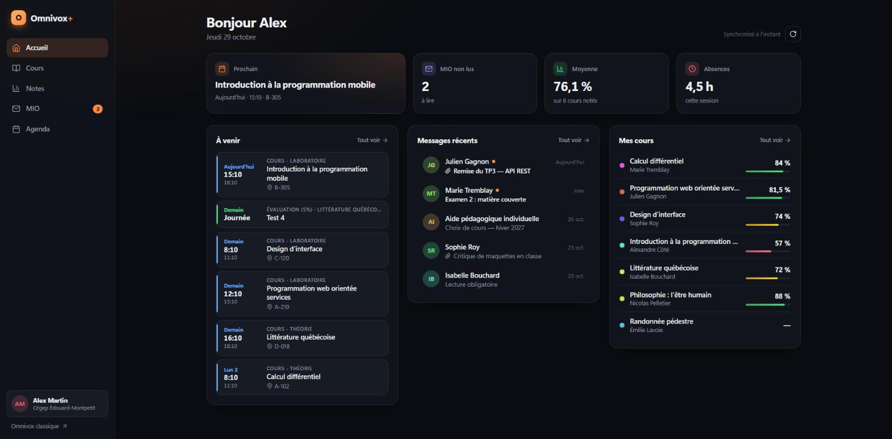
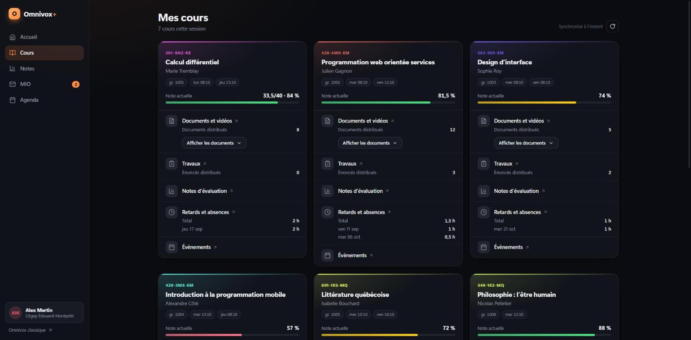

# Omnivox+

**Une interface moderne pour Omnivox du Cégep Édouard-Montpetit.**
*A modern interface for Cégep Édouard-Montpetit's Omnivox.*

[Français](#-français) · [English](#-english)



> Les captures utilisent des données fictives. · *Screenshots use fictional data.*

---

## 🇫🇷 Français

Omnivox+ est une extension Chrome qui affiche tes informations Omnivox et Léa dans une interface claire, rapide et uniforme. Elle réutilise ta session Omnivox déjà ouverte dans Chrome. **Elle ne demande et ne stocke jamais ton mot de passe.**

### Fonctionnalités

| Page | Contenu |
|---|---|
| **Accueil** | Prochain cours, MIO non lus, moyenne, absences, évènements à venir, derniers messages, résumé des cours |
| **Cours** | Une carte par cours : prof, horaire, note actuelle, documents (téléchargement en un clic), travaux, retards et absences |
| **Notes** | Détail de chaque évaluation, pondérations, moyenne, médiane et écart-type du groupe, écart avec le groupe |
| **MIO** | Liste et lecteur de messages, pièces jointes |
| **Agenda** | Évènements à venir groupés par jour (« Aujourd'hui », « Demain »), filtres par catégorie |

Également : thème sombre et clair automatiques, version mobile, affichage instantané grâce au cache local.



### Installation (environ 2 minutes)

1. Va dans [**Releases**](../../releases/latest) et télécharge le fichier `OmnivoxPlus-vX.Y.Z.zip`.
2. **Décompresse** le fichier (clic droit → *Extraire tout*). Tu obtiens un dossier `OmnivoxPlus`.
   Place-le à un endroit où il restera, par exemple dans *Documents* : Chrome le charge depuis ce dossier.
3. Dans Chrome, ouvre l'adresse `chrome://extensions`.
4. Active le **Mode développeur** (interrupteur en haut à droite).
5. Clique sur **Charger l'extension non empaquetée** et choisis le dossier `OmnivoxPlus`, celui qui contient `manifest.json`.
6. Épingle l'extension (icône de casse-tête 🧩 → 📌), puis clique sur **Omnivox+** pour l'ouvrir.

> Connecte-toi d'abord à Omnivox normalement dans Chrome. Si ta session expire, Omnivox+ affiche un bouton **Se connecter**, puis se met à jour tout seul à ton retour.

### Mise à jour

1. Télécharge le nouveau `.zip` dans [Releases](../../releases/latest).
2. Remplace le contenu de ton dossier `OmnivoxPlus` par celui du nouveau fichier, **au même emplacement**.
3. Dans `chrome://extensions`, clique sur ↻ sous Omnivox+.

### Confidentialité et sécurité

- **Aucun identifiant.** L'extension utilise la session Omnivox déjà ouverte dans ton navigateur.
- **Aucun serveur tiers.** Les seules requêtes vont vers `cegepmontpetit.omnivox.ca` et `cegepmontpetit-lea.omnivox.ca`, et la politique de sécurité de l'extension bloque toute autre destination.
- **Données locales seulement.** Un cache est gardé dans ton navigateur (`chrome.storage.local`) pour un affichage instantané. Rien n'est partagé.
- **Lecture seule.** L'extension ne fait aucune action à ta place. Seule exception : ouvrir un MIO le marque comme lu, comme dans Omnivox.
- **Contenu filtré.** Le corps des MIO passe par une liste blanche de balises, sans scripts, sans images et sans attributs.

### Limites

- Fonctionne seulement pour le **Cégep Édouard-Montpetit**.
- Omnivox n'a pas d'API publique : les données sont lues dans les pages HTML. Si Omnivox change son code, une section peut cesser de fonctionner jusqu'à la prochaine mise à jour.
- Pour répondre à un MIO, remettre un travail ou faire d'autres actions, des liens ouvrent Omnivox.

### Signaler un problème

Ouvre une [*issue*](../../issues) en décrivant la page concernée. Si possible, joins les lignes de la console (F12 → *Console*) qui commencent par `[Omnivox+]`. **Ne partage jamais de capture contenant tes notes ou tes messages.**

---

## 🇬🇧 English

Omnivox+ is a Chrome extension that shows your Omnivox and Léa information in a clean, fast and consistent interface. It reuses the Omnivox session already open in Chrome. **It never asks for or stores your password.**

### Features

| Page | Content |
|---|---|
| **Home** | Next class, unread MIO, average, absences, upcoming events, recent messages, course summary |
| **Courses** | One card per course: teacher, schedule, current grade, documents (one-click download), assignments, lateness and absences |
| **Grades** | Every evaluation, weights, group average, median and standard deviation, your gap with the group |
| **MIO** | Message list and reader, attachments |
| **Agenda** | Upcoming events grouped by day ("Today", "Tomorrow"), category filters |

Also: automatic dark and light themes, mobile layout, instant display thanks to a local cache.

> The interface is in French, like Omnivox.

### Installation (about 2 minutes)

1. Go to [**Releases**](../../releases/latest) and download `OmnivoxPlus-vX.Y.Z.zip`.
2. **Unzip** it (right-click → *Extract All*). You get an `OmnivoxPlus` folder.
   Put it somewhere permanent, for example *Documents*: Chrome loads the extension from this folder.
3. In Chrome, open `chrome://extensions`.
4. Turn on **Developer mode** (toggle in the top-right corner).
5. Click **Load unpacked** and select the `OmnivoxPlus` folder, the one that contains `manifest.json`.
6. Pin the extension (puzzle icon 🧩 → 📌), then click **Omnivox+** to open it.

> Log in to Omnivox in Chrome first. If your session expires, Omnivox+ shows a **Se connecter** (log in) button and refreshes on its own when you come back.

### Updating

1. Download the new `.zip` from [Releases](../../releases/latest).
2. Replace the contents of your `OmnivoxPlus` folder with the new files, **in the same location**.
3. In `chrome://extensions`, click ↻ under Omnivox+.

### Privacy and security

- **No credentials.** The extension uses the Omnivox session already open in your browser.
- **No third-party server.** The only requests go to `cegepmontpetit.omnivox.ca` and `cegepmontpetit-lea.omnivox.ca`, and the extension's Content Security Policy blocks any other destination.
- **Local data only.** A cache is kept in your browser (`chrome.storage.local`) for instant display. Nothing is shared.
- **Read-only.** The extension takes no action on your behalf. One exception: opening a MIO marks it as read, just like in Omnivox.
- **Sanitized content.** MIO bodies go through a tag allowlist, with no scripts, images or attributes.

### Limitations

- Works only for **Cégep Édouard-Montpetit**.
- Omnivox has no public API, so data is read from its HTML pages. If Omnivox changes its markup, a section may stop working until the next update.
- To reply to a MIO, submit an assignment or take other actions, links open Omnivox.

### Reporting a problem

Open an [issue](../../issues) describing the affected page. If possible, include the console lines (F12 → *Console*) that start with `[Omnivox+]`. **Never share screenshots containing your grades or messages.**

---

## Développement · Development

Aucune dépendance et aucune étape de compilation : du JavaScript (modules ES), du HTML et du CSS.
*No dependencies and no build step: plain ES modules, HTML and CSS.*

```
manifest.json        Manifest V3, permissions limitées aux domaines Omnivox
app.html / app.js    Interface
app.css              Thème (sombre et clair)
api/                 Lecture des pages Omnivox, Léa et MIO (fetch + DOMParser)
lib/dom.js           Création du DOM, icônes SVG, filtre HTML des MIO
dev/                 Aperçu local avec données fictives (exclu des releases)
```

**Aperçu local · Local preview** (sans compte Omnivox · no Omnivox account needed) :

```sh
node dev/serve.mjs
# http://localhost:8765/dev/preview.html   (mobile : /dev/mobile.html)
```

**Créer une release · Build a release** (le dossier `dev/` est exclu via `.gitattributes`) :

```sh
git archive --format=zip --prefix=OmnivoxPlus/ -o OmnivoxPlus-vX.Y.Z.zip HEAD
```

---

## Avertissement · Disclaimer

Projet étudiant indépendant, **non affilié** à Skytech Communications (Omnivox), ni au Cégep Édouard-Montpetit. « Omnivox » et « Léa » sont des marques de leurs propriétaires respectifs. Utilise l'extension à tes propres risques et dans le respect des conditions d'utilisation d'Omnivox.

*Independent student project, **not affiliated** with Skytech Communications (Omnivox) or Cégep Édouard-Montpetit. "Omnivox" and "Léa" are trademarks of their respective owners. Use at your own risk and in accordance with Omnivox's terms of use.*

Licence : [MIT](LICENSE)
