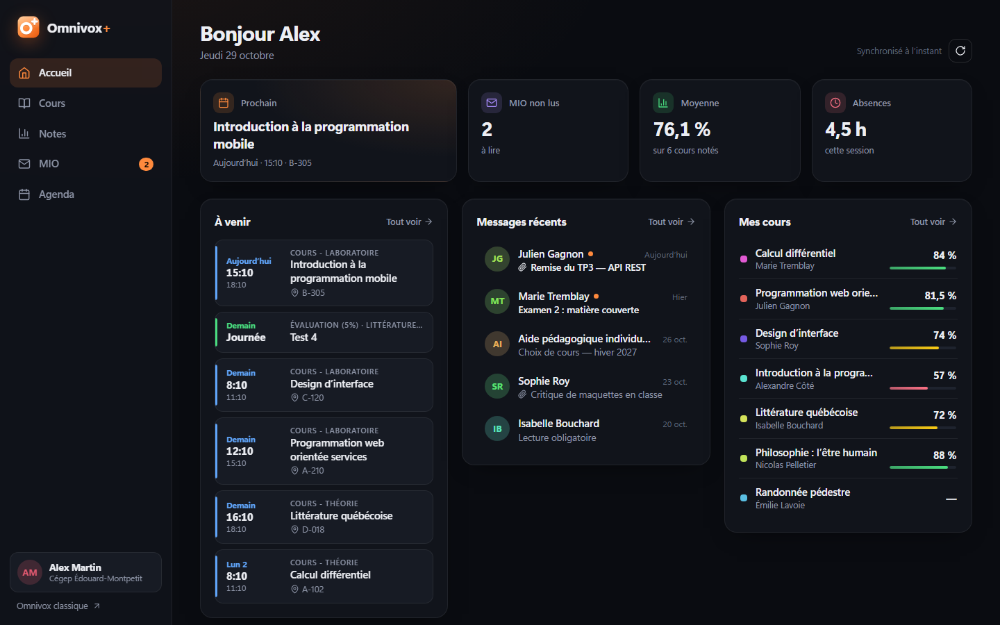
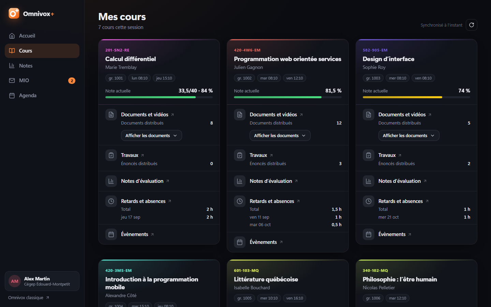
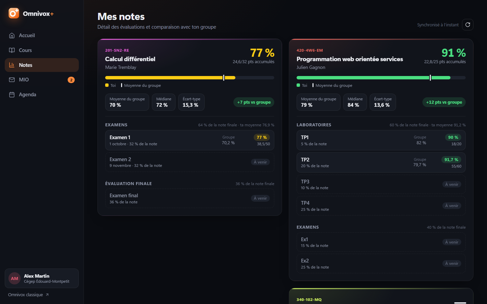

<p align="center">
  
</p>

<h1 align="center">Omnivox+</h1>

<p align="center">
  <strong>Une interface moderne pour Omnivox du Cégep Édouard-Montpetit.</strong><br>
  <em>A modern interface for Cégep Édouard-Montpetit's Omnivox.</em>
</p>

<p align="center">
  
  
  
  
</p>

<p align="center">
  <a href="#-français">Français</a> · <a href="#-english">English</a> · <a href="../../releases/latest"><strong>Télécharger · Download</strong></a>
</p>



> Les captures utilisent des données fictives. · *Screenshots use fictional data.*

---

## 🇫🇷 Français

Omnivox+ est une extension pour **Chrome** et **Firefox** qui affiche tes informations Omnivox et Léa dans une interface claire, rapide et uniforme. Elle réutilise ta session Omnivox déjà ouverte dans le navigateur. **Elle ne demande et ne stocke jamais ton mot de passe.**

### Fonctionnalités

| Page | Contenu |
|---|---|
| **Accueil** | Prochain cours, MIO non lus, moyenne, absences, évènements à venir, derniers messages, résumé des cours |
| **Cours** | Une carte par cours : prof, horaire, note actuelle, documents (téléchargement en un clic), travaux, retards et absences |
| **Notes** | Détail de chaque évaluation, pondérations, moyenne, médiane et écart-type du groupe, écart avec le groupe |
| **MIO** | Liste et lecteur de messages, pièces jointes |
| **Agenda** | Évènements à venir groupés par jour (« Aujourd'hui », « Demain »), filtres par catégorie |

Également : thème sombre et clair automatiques, version mobile, affichage instantané grâce au cache local.

| Cours | Notes |
|---|---|
|  |  |

### Installation

Télécharge d'abord la dernière version dans [**Releases**](../../releases/latest).

####  Chrome (aussi Edge et Brave)

1. Télécharge `OmnivoxPlus-vX.Y.Z.zip` et **décompresse-le** (clic droit → *Extraire tout*).
   Place le dossier `OmnivoxPlus` à un endroit où il restera, par exemple dans *Documents* : Chrome charge l'extension depuis ce dossier.
2. Ouvre l'adresse `chrome://extensions`.
3. Active le **Mode développeur** (interrupteur en haut à droite).
4. Clique sur **Charger l'extension non empaquetée** et choisis le dossier `OmnivoxPlus`, celui qui contient `manifest.json`.
5. Épingle l'extension (icône de casse-tête 🧩 → 📌), puis clique sur l'icône **Omnivox+**.

####  Firefox (version 140 ou plus récente)

**Version signée (recommandé) :** si la release contient un fichier `OmnivoxPlus-vX.Y.Z.xpi`, clique dessus. Firefox propose d'installer l'extension : clique sur **Ajouter**. C'est tout, et elle reste installée.

**Sinon, installation temporaire** (pour tester) :

1. Télécharge `OmnivoxPlus-vX.Y.Z.zip` et décompresse-le.
2. Ouvre l'adresse `about:debugging#/runtime/this-firefox`.
3. Clique sur **Charger un module complémentaire temporaire…** et choisis le fichier `manifest.json` du dossier `OmnivoxPlus`.

> Une extension temporaire est retirée quand Firefox se ferme. Il faut alors la recharger.

**Au premier lancement dans Firefox :** si Omnivox+ affiche « Accès à Omnivox requis », clique sur **Autoriser l'accès**. L'extension a besoin de lire les pages d'Omnivox et de Léa, et rien d'autre.

#### Ensuite (les deux navigateurs)

Connecte-toi à Omnivox normalement, puis ouvre Omnivox+. Si ta session expire, Omnivox+ affiche un bouton **Se connecter**, puis se met à jour tout seul à ton retour.

### Mise à jour

- **Chrome :** remplace le contenu du dossier `OmnivoxPlus` par celui du nouveau `.zip`, **au même emplacement**, puis clique sur ↻ dans `chrome://extensions`.
- **Firefox (version signée) :** ouvre le nouveau fichier `.xpi` de la release, et Firefox remplace l'ancienne version.

### Confidentialité et sécurité

- **Aucun identifiant.** L'extension utilise la session Omnivox déjà ouverte dans ton navigateur.
- **Aucun serveur tiers.** Les seules requêtes vont vers `cegepmontpetit.omnivox.ca` et `cegepmontpetit-lea.omnivox.ca`, et la politique de sécurité de l'extension bloque toute autre destination.
- **Aucune collecte de données.** Un cache est gardé dans ton navigateur (`storage.local`) pour un affichage instantané. Rien n'est transmis ni partagé.
- **Lecture seule.** L'extension ne fait aucune action à ta place. Seule exception : ouvrir un MIO le marque comme lu, comme dans Omnivox.
- **Contenu filtré.** Le corps des MIO passe par une liste blanche de balises, sans scripts, sans images et sans attributs.

### Limites

- Fonctionne seulement pour le **Cégep Édouard-Montpetit**.
- Omnivox n'a pas d'API publique : les données sont lues dans les pages HTML. Si Omnivox change son code, une section peut cesser de fonctionner jusqu'à la prochaine mise à jour.
- Pour répondre à un MIO, remettre un travail ou faire d'autres actions, des liens ouvrent Omnivox.

### Signaler un problème

Ouvre une [*issue*](../../issues) en précisant le navigateur et la page concernée. Si possible, joins les lignes de la console qui commencent par `[Omnivox+]` :

- **Chrome :** F12 sur la page Omnivox+ → *Console*.
- **Firefox :** `about:debugging` → **Examiner** à côté d'Omnivox+ → *Console*.

**Ne partage jamais de capture contenant tes notes ou tes messages.**

---

## 🇬🇧 English

Omnivox+ is an extension for **Chrome** and **Firefox** that shows your Omnivox and Léa information in a clean, fast and consistent interface. It reuses the Omnivox session already open in your browser. **It never asks for or stores your password.**

### Features

| Page | Content |
|---|---|
| **Home** | Next class, unread MIO, average, absences, upcoming events, recent messages, course summary |
| **Courses** | One card per course: teacher, schedule, current grade, documents (one-click download), assignments, lateness and absences |
| **Grades** | Every evaluation, weights, group average, median and standard deviation, your gap with the group |
| **MIO** | Message list and reader, attachments |
| **Agenda** | Upcoming events grouped by day ("Today", "Tomorrow"), category filters |

Also: automatic dark and light themes, mobile layout, instant display thanks to a local cache.

> The interface is in French, like Omnivox.

### Installation

First, download the latest version from [**Releases**](../../releases/latest).

####  Chrome (also Edge and Brave)

1. Download `OmnivoxPlus-vX.Y.Z.zip` and **unzip it** (right-click → *Extract All*).
   Keep the `OmnivoxPlus` folder somewhere permanent, for example *Documents*: Chrome loads the extension from this folder.
2. Open `chrome://extensions`.
3. Turn on **Developer mode** (toggle in the top-right corner).
4. Click **Load unpacked** and select the `OmnivoxPlus` folder, the one that contains `manifest.json`.
5. Pin the extension (puzzle icon 🧩 → 📌), then click the **Omnivox+** icon.

####  Firefox (version 140 or later)

**Signed version (recommended):** if the release includes an `OmnivoxPlus-vX.Y.Z.xpi` file, click it. Firefox offers to install the extension: click **Add**. That's it, and it stays installed.

**Otherwise, temporary install** (for testing):

1. Download `OmnivoxPlus-vX.Y.Z.zip` and unzip it.
2. Open `about:debugging#/runtime/this-firefox`.
3. Click **Load Temporary Add-on…** and select `manifest.json` in the `OmnivoxPlus` folder.

> A temporary add-on is removed when Firefox closes. You then need to load it again.

**First launch in Firefox:** if Omnivox+ shows "Accès à Omnivox requis" (Omnivox access required), click **Autoriser l'accès** (Allow access). The extension needs to read Omnivox and Léa pages, and nothing else.

#### Then (both browsers)

Log in to Omnivox as usual, then open Omnivox+. If your session expires, Omnivox+ shows a **Se connecter** (log in) button and refreshes on its own when you come back.

### Updating

- **Chrome:** replace the contents of the `OmnivoxPlus` folder with the new `.zip`, **in the same location**, then click ↻ in `chrome://extensions`.
- **Firefox (signed version):** open the new `.xpi` from the release, and Firefox replaces the old version.

### Privacy and security

- **No credentials.** The extension uses the Omnivox session already open in your browser.
- **No third-party server.** The only requests go to `cegepmontpetit.omnivox.ca` and `cegepmontpetit-lea.omnivox.ca`, and the extension's Content Security Policy blocks any other destination.
- **No data collection.** A cache is kept in your browser (`storage.local`) for instant display. Nothing is transmitted or shared.
- **Read-only.** The extension takes no action on your behalf. One exception: opening a MIO marks it as read, just like in Omnivox.
- **Sanitized content.** MIO bodies go through a tag allowlist, with no scripts, images or attributes.

### Limitations

- Works only for **Cégep Édouard-Montpetit**.
- Omnivox has no public API, so data is read from its HTML pages. If Omnivox changes its markup, a section may stop working until the next update.
- To reply to a MIO, submit an assignment or take other actions, links open Omnivox.

### Reporting a problem

Open an [issue](../../issues) stating your browser and the affected page. If possible, include the console lines that start with `[Omnivox+]`:

- **Chrome:** F12 on the Omnivox+ page → *Console*.
- **Firefox:** `about:debugging` → **Inspect** next to Omnivox+ → *Console*.

**Never share screenshots containing your grades or messages.**

---

## Développement · Development

Aucune dépendance et aucune étape de compilation : du JavaScript (modules ES), du HTML et du CSS. Un seul `manifest.json` pour Chrome et Firefox.
*No dependencies and no build step: plain ES modules, HTML and CSS. One `manifest.json` for both Chrome and Firefox.*

```
manifest.json        Manifest V3 (Chrome + Firefox), permissions limitées aux domaines Omnivox
app.html / app.js    Interface
app.css              Thème (sombre et clair)
api/                 Lecture des pages Omnivox, Léa et MIO (fetch + DOMParser)
lib/dom.js           Création du DOM, icônes SVG, filtre HTML des MIO
icons/               Logo (SVG) et icônes PNG 16/32/48/128
dev/                 Aperçu local avec données fictives (exclu des releases)
```

**Aperçu local · Local preview** (sans compte Omnivox · no Omnivox account needed) :

```sh
node dev/serve.mjs
# http://localhost:8765/dev/preview.html   (mobile : /dev/mobile.html)
```

**Créer une release · Build a release** (`dev/` et `docs/` sont exclus via `.gitattributes`) :

```sh
git archive --format=zip --prefix=OmnivoxPlus/ -o OmnivoxPlus-vX.Y.Z.zip HEAD
```

Pour Firefox, le même `.zip` peut être envoyé sur [addons.mozilla.org](https://addons.mozilla.org/developers/) en mode « non répertorié » pour obtenir un `.xpi` signé.
*For Firefox, the same `.zip` can be submitted to [addons.mozilla.org](https://addons.mozilla.org/developers/) as "unlisted" to get a signed `.xpi`.*

---

## Avertissement · Disclaimer

Projet étudiant indépendant, **non affilié** à Skytech Communications (Omnivox), ni au Cégep Édouard-Montpetit. « Omnivox » et « Léa » sont des marques de leurs propriétaires respectifs. Utilise l'extension à tes propres risques et dans le respect des conditions d'utilisation d'Omnivox.

*Independent student project, **not affiliated** with Skytech Communications (Omnivox) or Cégep Édouard-Montpetit. "Omnivox" and "Léa" are trademarks of their respective owners. Use at your own risk and in accordance with Omnivox's terms of use.*

Licence : [MIT](LICENSE)
